<picture>
  <source media="(prefers-color-scheme: dark)" srcset="assets/header-dark.svg">
  <source media="(prefers-color-scheme: light)" srcset="assets/header-light.svg">
  
</picture>

# Hi, I'm Prathamesh Pal 👋
### FULL-STACK DEVELOPER & STUDENT 

I’m **Prathamesh Pal** - a curious learner who loves exploring how things work in code, math, and life.

I enjoy building with **Python** and **JavaScript**, and I’m driven by a constant desire to understand, create, and improve.

- 🌍 **Portfolio:** [prathamesh-pal.github.io](https://prathamesh-pal.github.io)
- 🌱 **Learning:** Advanced Backend Architecture
- 📫 **Contact:** [Gmail : ](mailto:your-prathameshpal.tech.gmail.com)

---

### 🛠️ Tech Stack

**Languages & Frameworks**  

**Tools & Workflow**  

---

<picture>
  <source media="(prefers-color-scheme: dark)" srcset="assets/divider-dark.svg">
  <source media="(prefers-color-scheme: light)" srcset="assets/divider-light.svg">
  
</picture>

<picture>
  <source media="(prefers-color-scheme: dark)" srcset="assets/divider-dark.svg">
  <source media="(prefers-color-scheme: light)" srcset="assets/divider-light.svg">
  
</picture>
